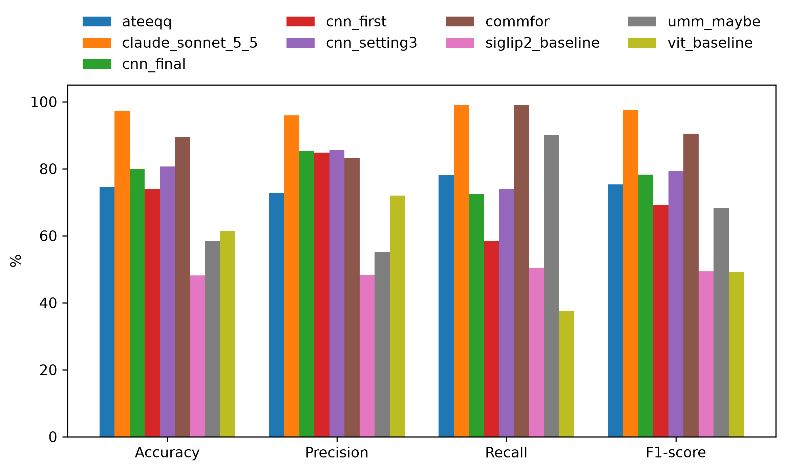

# AI-Generated Image Detection System

Graduation project (Bachelor of Cybersecurity). It measures eight ways of telling real photographs from AI-generated images on the same 384 images: five published detectors, a CNN fine-tuned in this project (first attempt and final model), and a general-purpose multimodal model. It also provides a small web page for trying the fine-tuned detector.

Trained model: [mkk1135/ai-image-detector](https://huggingface.co/mkk1135/ai-image-detector)

Online demo: [huggingface.co/spaces/mkk1135/ai-image-detector](https://huggingface.co/spaces/mkk1135/ai-image-detector)

## Try the detector

**In the browser, with nothing to install:** open the [online demo](https://huggingface.co/spaces/mkk1135/ai-image-detector) and choose an image. The detector runs inside your browser, so the image never leaves your device. The first visit downloads the detector (about 110 MB). Of an image larger than 1024 px the demo analyses only the central 1024 x 1024 px; run that way the detector scores 78.9% on the main test set (`results/main/crop1024/`), against 80.0% for whole images. On eight test images its output matched the Python detector to within 0.0001.

**On your own computer:**

```bash
pip install -r requirements.txt
python app.py
```

Then open http://127.0.0.1:7860 and upload an image. The image is analysed on your own computer and is not sent anywhere. The page shows the answer, the confidence, and a warning when the decision is weak (confidence below 75%). Of an image larger than 2048 px only the central 2048 x 2048 px are analysed.

The answer is an indication, not proof: on the main test set the detector was wrong about one time in five.

## Results

Main test set: 384 images, 192 real photographs (Wikimedia Commons, Unsplash and Open Images, 64 each) and 192 AI-generated images from 21 generators that are not in the training data. "Real" is the positive class. The 95% confidence intervals are Wilson score intervals.

| Approach | Accuracy | 95% CI | Precision | Recall | F1 | Real correct | AI correct |
|---|---|---|---|---|---|---|---|
| Claude Sonnet 5.5, asked "Real or AI-Generated?" (blind) | 97.40% | 95.3 to 98.6 | 95.96% | 98.96% | 97.44% | 190 / 192 | 184 / 192 |
| Community Forensics detector (`OwensLab/commfor-model-384`) | 89.58% | 86.1 to 92.3 | 83.33% | 98.96% | 90.48% | 190 / 192 | 154 / 192 |
| **CNN fine-tuned in this project, final** (`mkk1135/ai-image-detector`) | 79.95% | 75.7 to 83.6 | 85.28% | 72.40% | 78.31% | 139 / 192 | 168 / 192 |
| SigLIP detector (`Ateeqq/ai-vs-human-image-detector`) | 74.48% | 69.9 to 78.6 | 72.82% | 78.12% | 75.38% | 150 / 192 | 136 / 192 |
| CNN of this project, first attempt | 73.96% | 69.3 to 78.1 | 84.85% | 58.33% | 69.14% | 112 / 192 | 172 / 192 |
| ViT detector (`Manish18/deepfake-detection-model`) | 61.46% | 56.5 to 66.2 | 72.00% | 37.50% | 49.32% | 72 / 192 | 164 / 192 |
| Swin detector (`umm-maybe/AI-image-detector`) | 58.33% | 53.3 to 63.2 | 55.10% | 90.10% | 68.38% | 173 / 192 | 51 / 192 |
| SigLIP2 detector (`prithivMLmods/deepfake-detector-model-v1`) | 48.18% | 43.2 to 53.2 | 48.26% | 50.52% | 49.36% | 97 / 192 | 88 / 192 |



What the results show:

- The multimodal model is the most accurate by a wide margin and is consistent across all sources of images.
- Published detectors differ enormously, from no better than guessing (48.2%) to 89.6%, and a model page does not tell which kind a detector is. One calls most generated images real, another calls most photographs generated.
- The fine-tuned CNN reaches 80.0%. It is clearly better than three of the five published detectors, not clearly better than the fourth, and clearly worse than the Community Forensics detector (see the tests below).
- When every image is re-compressed as JPEG, the Community Forensics detector falls to 81.0% and the fine-tuned CNN (81.8%) is level with it.
- The fine-tuned CNN's dominant error is calling a real photograph generated. It is worst on small, strongly downscaled web photographs: it recognises only 31 of the 64 Open Images photographs.

### Tests against the final CNN

Exact McNemar test on the same 384 images. Only images on which two approaches disagree count.

| Approach | Only the final CNN right | Only this approach right | p-value | Result |
|---|---|---|---|---|
| Claude Sonnet 5.5 | 5 | 72 | < 0.001 | more accurate than the final CNN |
| Community Forensics detector | 30 | 67 | < 0.001 | more accurate than the final CNN |
| Ateeqq SigLIP detector | 65 | 44 | 0.055 | no significant difference |
| CNN, first attempt | 50 | 27 | 0.012 | less accurate than the final CNN |
| Manish18 ViT detector | 104 | 33 | < 0.001 | less accurate than the final CNN |
| umm-maybe Swin detector | 134 | 51 | < 0.001 | less accurate than the final CNN |
| prithivMLmods SigLIP2 detector | 157 | 35 | < 0.001 | less accurate than the final CNN |
| CNN, setting 3 (predecessor of the final model) | 13 | 16 | 0.711 | no significant difference |

No correction for multiple comparisons was applied. The result for the first attempt (p = 0.012) would not survive one.

### By source

Images classified correctly.

| Approach | Wikimedia Commons (64) | Unsplash (64) | Open Images (64) | Commercial generators (132) | Open-source generators (60) |
|---|---|---|---|---|---|
| Claude Sonnet 5.5 | 64 | 63 | 63 | 131 | 53 |
| Community Forensics detector | 64 | 62 | 64 | 95 | 59 |
| **CNN, final** | 54 | 54 | 31 | 122 | 46 |
| Ateeqq SigLIP detector | 50 | 51 | 49 | 109 | 27 |
| CNN, first attempt | 40 | 43 | 29 | 125 | 47 |
| Manish18 ViT detector | 25 | 24 | 23 | 120 | 44 |
| umm-maybe Swin detector | 59 | 64 | 50 | 31 | 20 |
| prithivMLmods SigLIP2 detector | 35 | 28 | 34 | 60 | 28 |

The two best detectors have opposite weaknesses. The Community Forensics detector recognises almost every photograph but misses 37 of the 132 images from commercial generators. The fine-tuned CNN recognises 122 of those 132 but fails on the Open Images photographs. The two detectors gave the same answer for 287 of the 384 images, and that shared answer was right for 277 of them (96.5%). This was noticed after the fact and is not a tested method.

### After JPEG re-compression

Most generated images in the set are unedited PNG files and the photographs are JPEG files, so a detector could be reading the file format. Every image was therefore re-compressed as JPEG at quality 90 and scored again (`results/main/jpeg90/`).

| Detector | As downloaded | After JPEG 90 | Real correct after | AI correct after | p-value against the final CNN, after |
|---|---|---|---|---|---|
| **CNN, final** | 79.95% | 81.77% | 150 / 192 | 164 / 192 |  |
| Community Forensics detector | 89.58% | 80.99% | 190 / 192 | 121 / 192 | 0.851 |
| Ateeqq SigLIP detector | 74.48% | 74.74% | 147 / 192 | 140 / 192 | 0.009 |
| CNN, first attempt | 73.96% | 73.44% | 121 / 192 | 161 / 192 | 0.001 |
| Manish18 ViT detector | 61.46% | 60.94% | 73 / 192 | 161 / 192 | < 0.001 |
| umm-maybe Swin detector | 58.33% | 58.07% | 175 / 192 | 48 / 192 | < 0.001 |
| prithivMLmods SigLIP2 detector | 48.18% | 47.92% | 96 / 192 | 88 / 192 | < 0.001 |

The fine-tuned CNN hardly changes. The Community Forensics detector loses 33 generated images, so part of its lead on unedited files comes from the difference in format. The re-compressed runs were planned; the test between the two detectors was added after the size of the change had been seen.

### How far to trust these numbers

- With 384 images the confidence interval of an accuracy near 80% is about four points either side. The figures per source and per generator rest on 64 or fewer images.
- The real photographs come from three published collections, and the generated images are unedited output from one benchmark. Screenshots, scans, drawings, edited photographs, and generated images that were resized, edited or shared through social media were not tested.
- The fine-tuned CNN is likely to flag photographs that are small, blurred or strongly resized (see below and the by-source table).
- The detector's confidence is not a calibrated probability. Of its 62 decisions below 75% confidence, 61% were right; of its 248 decisions at 90% or more, 85% were right.
- No decision about the detector was taken on the main test set: the training setting was chosen on the check set and the model was published before anything was scored on it.
- Each model was trained once and Claude was asked once. The variation between runs was not measured.
- Claude saw JPEG copies with a longest side of at most 1568 px; the detectors saw the files as downloaded. Whether any test image was in the training data of Claude or of the published detectors is not known.
- The published detectors are used exactly as published. The Community Forensics detector was trained on its authors' full dataset, which also contains images from commercial generators, and the generated test images come from the same authors' evaluation set.
- `check_overlap.py` found none of the 287 real evaluation photographs among the 18,978 real training images of the fine-tuned CNN (`results/overlap_check.txt`; two training images share a hash, so the file counts 18,977). A copy that was cropped differently would be missed.

## The pilot test set, and why it was replaced

During most of the project the only test set had 48 images (26 photographs from Wikimedia Commons, 22 images from 11 commercial generators).

| Approach | Accuracy (48 images) | Real correct | AI correct | Accuracy on the main test set (384 images) |
|---|---|---|---|---|
| Claude Sonnet 5.5 | 97.92% | 26 / 26 | 21 / 22 | 97.40% |
| CNN, setting 3 | 97.92% | 25 / 26 | 22 / 22 | 80.73% |
| Community Forensics detector | 95.83% | 26 / 26 | 20 / 22 | 89.58% |
| Ateeqq SigLIP detector | 87.50% | 24 / 26 | 18 / 22 | 74.48% |
| **CNN, final** | 87.50% | 21 / 26 | 21 / 22 | 79.95% |
| Manish18 ViT detector | 72.92% | 16 / 26 | 19 / 22 | 61.46% |
| CNN, first attempt | 70.83% | 14 / 26 | 20 / 22 | 73.96% |
| umm-maybe Swin detector | 66.67% | 25 / 26 | 7 / 22 | 58.33% |
| prithivMLmods SigLIP2 detector | 47.92% | 15 / 26 | 8 / 22 | 48.18% |

On these 48 images an earlier version of the CNN (setting 3) appeared to match Claude. On 384 images from three sources it is 17 points behind. The pilot set was small (one image is worth two points) and narrow: its photographs come from the same source as the check set used for tuning, and its generated images are all from commercial generators, the two kinds of image on which the CNN is strongest. Results on the pilot set are in `results/`.

## How the final CNN was chosen

Four training settings were compared on a separate check set of 157 images (69 real, 88 AI-generated) that shares no image and no photographer with the test sets. The rule for accepting a setting was fixed before it was scored.

| Setting | Check accuracy | Real correct | AI correct | After JPEG 90 |
|---|---|---|---|---|
| 1. Whole image shrunk to 224 px (first attempt) | 79.62% | 41 / 69 | 84 / 88 | 79.62% |
| 2. Crops at original resolution | 76.43% | 33 / 69 | 87 / 88 | 77.07% |
| 3. Setting 2, plus 7,010 photographs and 149 more generators | 88.54% | 58 / 69 | 81 / 88 | 87.90% |
| 4. Setting 3, plus blur and noise in training (final) | 89.17% | 59 / 69 | 81 / 88 | 87.26% |

Setting 2 was not adopted: it caught almost every AI image but called more than half of the real photographs generated (13 of 15 landscapes right, 1 of 15 food photographs). `diagnose.py` showed why. The table gives the check-set images classified correctly after one processing step (`results/check/diagnosis.txt`):

| Processing step | Setting 2: real | Setting 2: AI | Setting 3: real | Setting 3: AI | Setting 4: real | Setting 4: AI |
|---|---|---|---|---|---|---|
| as downloaded | 33 | 87 | 58 | 81 | 59 | 81 |
| Gaussian blur, radius 0.6 | 15 | 87 | 34 | 82 | 40 | 81 |
| Gaussian blur, radius 1.0 | 2 | 88 | 23 | 81 | 45 | 78 |
| unsharp mask (sharpen) | 43 | 87 | 64 | 81 | 62 | 80 |
| downscaled to half size | 34 | 87 | 50 | 83 | 41 | 86 |
| Gaussian noise, sd 3 | 27 | 88 | 32 | 84 | 63 | 78 |
| Mean accuracy over the six rows | 72.0% |  | 79.9% |  | 84.3% |  |

Setting 2 treated clean, smooth images as generated. The cause was the training data: its clean, high-quality real images showed only landscapes and faces. Setting 3 adds 7,010 photographs of varied subjects and replaced setting 1. Setting 4 adds random blur and noise to the training augmentation. Its rule was: adopt it if the mean over the six rows is higher than for setting 3 and the accuracy as downloaded is not more than two points lower. Both held, so setting 4 is the final model. It is much steadier under noise and strong blur, but it got worse on downscaled photographs and a slight blur still costs it 19 of 59 real photographs.

## Evaluation sets

`results/test_set.csv` (pilot), `results/check/check_set.csv` and `results/main/main_set.csv` list every image with its author or generator, licence and source URL. The images themselves are not in this repository.

- **Wikimedia Commons:** categories "Quality images of ...". In each category the most recently added JPEG files with camera EXIF data and a width of at least 2000 px, one per uploader, at 1920 px width. Each set excludes the files and photographers of the sets before it. Drawn on 18 November 2026.
- **Unsplash** (main set only): a seeded random sample of the [Unsplash Lite dataset](https://github.com/unsplash/datasets), photographs with camera EXIF data, at 1920 px width.
- **Open Images** (main set only): a seeded random sample of the Open Images V7 validation set (Flickr photographs under CC BY 2.0), as distributed, at most 1024 px.
- **AI-generated:** the [Community Forensics evaluation set](https://huggingface.co/datasets/OwensLab/CommunityForensics-Eval). 11 commercial generators (Midjourney v5.2 and v6.1, DALL-E 2 and 3, Firefly Image 2 and 3, Imagen 3, Ideogram v1 and v2, FLUX dev and schnell) in all three sets; the main set adds 10 open-source generators (Hourglass, DF-GAN, GALIP, Kandinsky 2.2, Stable Cascade, DeciDiffusion v2, three LCM-LoRA models and a Midjourney-style adapter for Stable Diffusion v1.5). None of the 21 is in the training data, but the LCM-LoRA models and the adapter are built on Stable Diffusion models, the family that dominates the training data.

```bash
python make_test_set.py test
python make_test_set.py check
python make_test_set.py main
```

The Commons draw depends on the day it is run, so the script refuses to overwrite an existing list.

## Training

`train.py` fine-tunes ConvNeXt-Tiny (`facebook/convnext-tiny-224`), a CNN pretrained on ImageNet, for three epochs on 36,562 images. A random 10% is held out for validation.

| Class | Source | Images |
|---|---|---|
| Generated | [Community Forensics-Small](https://huggingface.co/datasets/OwensLab/CommunityForensics-Small) (Park and Owens, CVPR 2025): 377 community Stable Diffusion models | 14,592 |
| Generated | Community Forensics-Small: GLIDE, DeepFloyd IF, BigGAN | 2,992 |
| Real | Community Forensics-Small: COCO (4,831), VISION (1,153), Landscapes HQ (2,992), FFHQ (2,992) | 11,968 |
| Real | [DataSeeds.AI Sample Dataset](https://huggingface.co/datasets/Dataseeds/DataSeeds.AI-Sample-Dataset-DSD): peer-ranked photographs of varied subjects | 7,010 |

Images flagged NSFW by Community Forensics are removed.

The model trains on 256 x 256 crops taken at the images' original resolution, and at inference it sees the whole image without resizing, because shrinking an image removes the fine traces that generators leave. Training images are randomly downscaled, flipped, blurred, given noise and JPEG-compressed up to twice, so that the model cannot use an image's processing history (generated images are uncompressed PNG, most real ones JPEG) or its sharpness as a shortcut.

```bash
pip install -r requirements.txt
python train.py --hub-id YOUR_HF_USERNAME/ai-image-detector
```

This needs a GPU and downloads about 19 GB; it took about 29 minutes of training on an RTX 4070 laptop GPU. `python train.py --resume` continues an interrupted run from the last checkpoint. `train.ipynb` runs the same script on a free Google Colab GPU, but it has not been tested there. To check the pipeline in two minutes on a CPU, with nothing uploaded:

```bash
python train.py --dry-run
```

## Evaluation

```bash
python evaluate.py MODEL_ID --real data/main/real --ai data/main/ai --name short_name --out results/main
python evaluate.py MODEL_ID --real data/main/real --ai data/main/ai --name short_name --out results/main/jpeg90 --jpeg 90
python evaluate.py --compare cnn_final --out results/main
python evaluate.py --chart --out results/main
python diagnose.py MODEL_ID
python check_overlap.py
python evaluate.py MODEL_ID --real data/main/real --ai data/main/ai --name short_name --out results/main/crop1024 --crop 1024
python export_onnx.py
```

Each evaluation run writes the metrics with a confidence interval, per-image predictions and a confusion matrix. `--compare` writes `significance.csv`, the McNemar test of every model in the folder against the named one. `diagnose.py` reports how blur, sharpening, downscaling and noise change a detector's answers on the check set. `check_overlap.py` checks that no real evaluation photograph is also a training image. `commfor.py` loads the published Community Forensics detector, which is not a standard Transformers model. `--crop 1024` scores a detector on the central 1024 x 1024 px only, as the online demo analyses images. `export_onnx.py` writes the detector as `space/model.onnx` for the online demo (`space/index.html`) and checks that it gives the same output as the PyTorch model; it needs `pip install onnx onnxscript onnxruntime`. `space/check_demo.py` uploads images to the demo page in a real browser and compares its answers with the Python detector (`results/demo_check.txt`).

## Database of all results and full comparison

```bash
python analyse_models.py
python results_db.py
```

`results_db.py` puts every prediction of every approach on every evaluation image into one small SQLite database, `results/results.db`, checks it against the result files, and writes [COMPARISON.md](COMPARISON.md) from it: what each model is (architecture, size, file format, licence, model card), accuracy on every set, results by source and by generator, ranking quality (AUC), confidence, speed, sensitivity to blur and noise, and a table of what has and has not been measured. `analyse_models.py` inspects the files of each detector and times it on the processor; its output, `results/models.json`, feeds the database.

| Table or view | Content |
|---|---|
| `images` | one row per evaluation image: set, class, source group, generator or photo category, author, licence, URL |
| `models` | one row per approach: architecture, number of weights, file size and format, input size, licence, speed |
| `predictions` | one row per model, set, condition and image: the answer and its score |
| `processing` | check-set images still classified correctly after blur, sharpening, downscaling or noise |
| `scores`, `by_group`, `by_generator` | views: accuracy per model, set and condition; correct answers per source and per generator |

```bash
sqlite3 results/results.db "select model, accuracy from scores where set_name = 'main' and condition = 'as downloaded' order by 2 desc"
```

## Blind test of a chat model

```bash
python blind_test.py prepare --set main
python blind_test.py score answers.txt claude --model "model name" --set main
```

`prepare` writes shuffled copies of the images with neutral file names and no metadata, all re-encoded as JPEG. The model is shown each copy with the question "Is this image a real photograph taken by a camera, or is it AI-generated / synthetic? Answer with only one word: Real or AI-Generated." and nothing else.

The Claude rows above were measured this way on 18 November 2026 with Claude Sonnet 5.5 (`claude-sonnet-5-5`), run as separate agents (one for the pilot set, eight for the main set with 48 images each) that were given only a folder of anonymised copies and told to open nothing else. Each was a single pass with no retries; the raw answers are in `results/claude_blind_answers.txt` and `results/main/claude_blind_answers.txt`.
