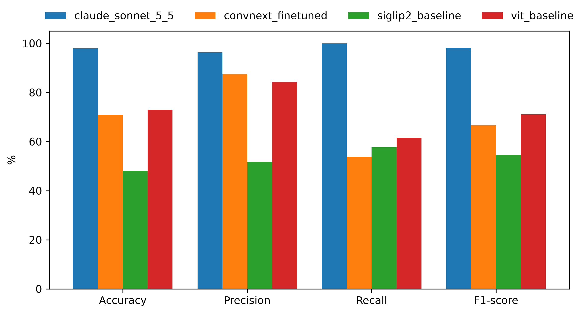

# AI-Generated Image Detection System

Graduation project (Bachelor of Cybersecurity). It compares four ways of telling real photographs from AI-generated images on one fixed test set, and fine-tunes a CNN on varied data to address the failure of off-the-shelf detectors on images unlike their training data.

## Results

48 test images: 26 real photographs and 22 AI-generated images. "Real" is the positive class.

| Model | Accuracy | Precision | Recall | F1 | Real correct | AI correct |
|---|---|---|---|---|---|---|
| ViT detector (`Manish18/deepfake-detection-model`) | 72.92% | 84.21% | 61.54% | 71.11% | 16 / 26 | 19 / 22 |
| SigLIP2 detector (`prithivMLmods/Deep-Fake-Detector-Model`) | 47.92% | 51.72% | 57.69% | 54.55% | 15 / 26 | 8 / 22 |
| ConvNeXt-Tiny CNN fine-tuned in this project | 70.83% | 87.50% | 53.85% | 66.67% | 14 / 26 | 20 / 22 |
| Claude Sonnet 5.5, asked "Real or AI-Generated?" (blind) | 97.92% | 96.30% | 100.00% | 98.11% | 26 / 26 | 21 / 22 |



The fine-tuned CNN reached 98.4% accuracy on held-out images from its own training dataset but only 70.8% on this test set, where it labelled 12 of the 26 real photographs as AI-generated. Fine-tuning on more varied data therefore did not remove the domain-shift failure: the CNN does no better than the off-the-shelf ViT detector, and both are far behind the general-purpose multimodal model.

Per-image predictions and confusion matrices are in `results/`.

Limits of these numbers: with 48 images, one image is worth about 2 percentage points, so small gaps between models mean little. Every AI image in the set is square and most photographs are not. The two off-the-shelf detectors are used exactly as published.

## Test set

`results/test_set.csv` lists every image with its author or generator, licence and source URL. The images themselves are not in this repository; `python make_test_set.py` downloads them.

- **Real (26):** Wikimedia Commons, from the categories Quality images of people (5), streets (5), landscapes (4), buildings (4), birds (4) and food (4). In each category the most recently added JPEG files with camera EXIF data and a width of at least 2000 px were taken, one per uploader, at 1920 px width. Drawn on 18 November 2026.
- **AI-generated (22):** the [Community Forensics evaluation set](https://huggingface.co/datasets/OwensLab/CommunityForensics-Eval), two images from each of 11 commercial generators: Midjourney v5.2 and v6.1, DALL-E 2 and 3, Firefly Image 2 and 3, Imagen 3, Ideogram v1 and v2, FLUX dev and schnell. None of these generators is in the training data.

## Training

`train.py` fine-tunes ConvNeXt-Tiny (`facebook/convnext-tiny-224`), a CNN pretrained on ImageNet, for three epochs.

Training data is a 24,000-image subset of [Community Forensics-Small](https://huggingface.co/datasets/OwensLab/CommunityForensics-Small) (Park and Owens, CVPR 2025), half real and half generated:

| Class | Source | Images |
|---|---|---|
| Generated | 228 community Stable Diffusion models (latent diffusion) | about 8,800 |
| Generated | GLIDE, DeepFloyd IF (pixel diffusion), BigGAN | 3,000 |
| Real | COCO | 4,800 |
| Real | VISION (full-resolution camera photographs) | 1,200 |
| Real | Landscapes HQ | 3,000 |
| Real | FFHQ portraits | 3,000 |

Images flagged NSFW by the dataset are removed, and a random 10% is held out for validation. Training images are randomly cropped, flipped and JPEG-compressed, so that the model cannot use the file format (generated images are PNG, most real ones JPEG) as a shortcut.

```bash
pip install -r requirements.txt
python train.py --hub-id YOUR_HF_USERNAME/ai-image-detector
```

This needs a GPU and downloads about 12 GB. On a free Google Colab GPU, open `train.ipynb`, set the runtime to T4 GPU and run all cells. To check the pipeline in two minutes on a CPU, with nothing uploaded:

```bash
python train.py --dry-run
```

## Evaluation

```bash
python make_test_set.py
python evaluate.py MODEL_ID --real data/test/real --ai data/test/ai --name short_name
python evaluate.py --chart
```

## Blind test of a chat model

```bash
python blind_test.py prepare
python blind_test.py score answers.txt claude --model "model name"
```

`prepare` writes shuffled copies of the test images with neutral file names and no metadata, all re-encoded as JPEG. The model is shown each copy with the question "Is this image a real photograph taken by a camera, or is it AI-generated / synthetic? Answer with only one word: Real or AI-Generated." and nothing else.

The Claude row above was measured this way on 18 November 2026 with Claude Sonnet 5.5 (`claude-sonnet-5-5`), run as a separate agent that was given only the folder of anonymised copies and told to open nothing else. It was a single pass with no retries; its raw answers are in `results/claude_blind_answers.txt`.
